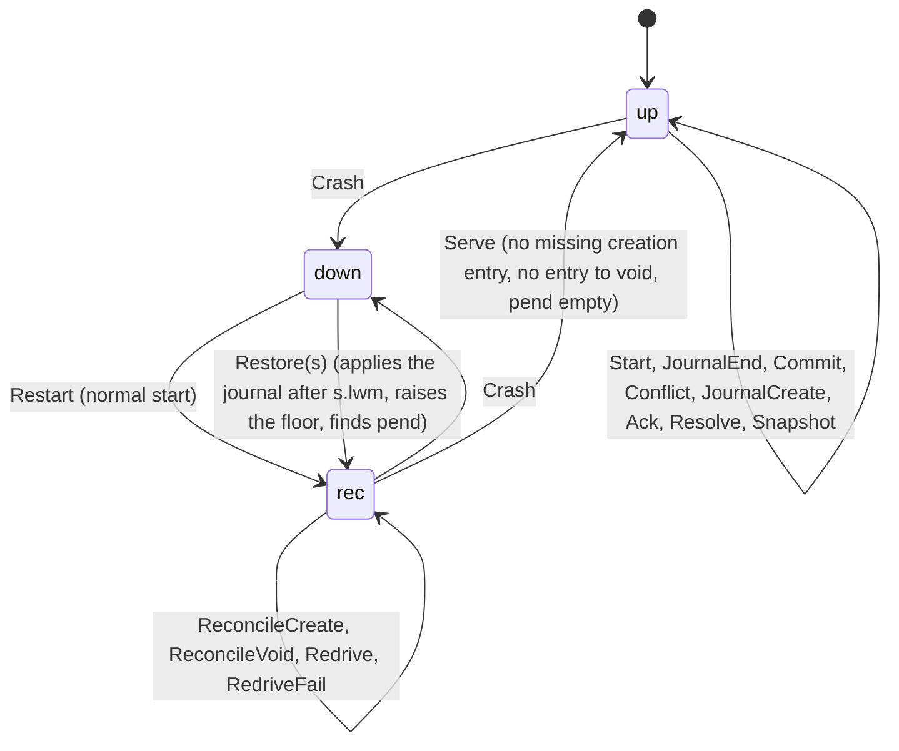
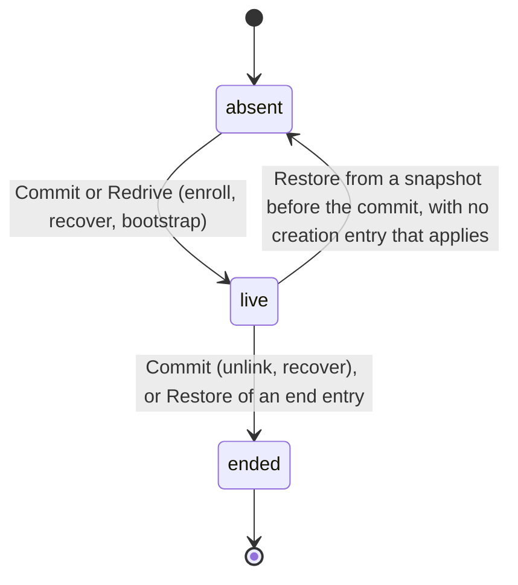
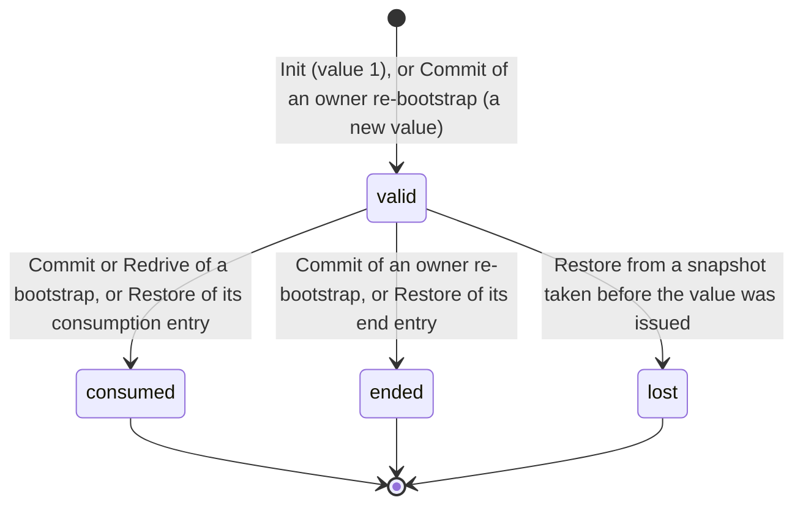

# Statecharts of the authority-restore models

These charts come from the actions of `Authority.tla` and `Replay.tla`, the design as selected on
2026-11-07, and the owner re-bootstrap and the acknowledgement order selected on 2026-11-08. The checkers are the acceptance authority; a chart only shows the shape. Each chart
names the transitions that it merges or hides. No chart shows a known-bad variant.

## Store phase

Hidden or merged: the `restored` flag, which `Restore` sets and no step of the design clears; the
journal variables; the snapshot set. `Serve` is the only way back to `up`, so no in-doubt
consumption and no unreconciled entry remains while the store serves (`NoDoubtServing`).

## One operation

```mermaid
stateDiagram-v2
    [*] --> idle
    idle --> checked: Start (check and turn)
    checked --> journaled: JournalEnd (end entry durable)
    checked --> committed: Commit (no end entry)
    journaled --> committed: Commit
    checked --> refused: Conflict (no end entry; no void)
    journaled --> refused: Conflict (void written before the refusal)
    committed --> created: JournalCreate (an anchor)
    committed --> acked: Ack (no anchor, or its creation entry written; no creation pending)
    created --> acked: Ack (no creation pending)
    checked --> cChecked: Crash
    journaled --> cJournaled: Crash
    committed --> cCommitted: Crash
    created --> cCreated: Crash
    cCommitted --> acked: Resolve (outcome lookup; no creation pending)
    cCreated --> acked: Resolve (no creation pending)
    cJournaled --> acked: Resolve, after a Redrive committed it (no creation pending)
    acked --> [*]
    refused --> [*]
```

Hidden or merged: the seven transition kinds of `Start`, the owner re-bootstrap included; the turn (`lock`); `Redrive` and
`RedriveFail`, which change the store and not `pc`: a redrive commits a crashed consumption
(`cJournaled`, or `cCommitted` and `cCreated` in an abandoned history) again, under its operation
identity, and its client then finds the outcome by `Resolve`. A crashed operation that never
committed stays at its crash point; reconciliation voids its end entry when its fact does not hold.
`Resolve` also needs the creation entry of an operation that makes an anchor; reconciliation
writes it before `Serve`. "No creation pending" is the guard `CreationPending` of 2026-11-08: an anchor change of an owner
is acknowledged, and a lookup reports it, only after each other commit of that owner that created
an anchor has its creation entry. Without it (`ackEarly`), an unlink acknowledged next to an
enrollment whose creation entry is still to come lets a restore remove the new anchor.

## Anchor life (store)

Hidden or merged: the anchor kinds (passkey, provider link, recovery value, and the
administrator binding, which stands for the bootstrapped CLI credential) and the journal state of
each anchor. Agent identities are not anchors, and they are not in the chart. An ended anchor never returns to `live`. An
administrator binding ends only through an unlink with the last-anchor check, which keeps another
administrator that the journal records as live.

## Bootstrap value life (store)

Hidden or merged: `lost` is not a store value: the restored store does not hold the value
(`bvals`), and the owner issues a new one. A value can be both consumed and ended when a restore
applies the entries of an in-doubt consumption and an in-doubt re-bootstrap; it is not valid in
either case, and the completion of that consumption refuses. At most one value is valid at a time
(`OneBootValid`).

## Replay record life

```mermaid
stateDiagram-v2
    [*] --> absent
    absent --> checked: Check (window, verifier reading)
    checked --> present: Insert (absent, above the floor, store reading before expires + skew)
    checked --> absent: Insert refuses (present, at or below the floor, or store reading at or past expires + skew)
    present --> absent: Expire (store reading past expires + skew + 2U)
    present --> absent: Start (restart or restore; sets the floor)
```

Hidden or merged: the two verifiers (each has its own `checked` state, so one verifier can be
`checked` while the record is `present`); `Tick`; the readings. The insert check closes the path
where a verifier stays `checked` while the record goes `present --> absent` by `Expire` and then
inserts again: the store reading at that insert is past `expires` plus the skew.
